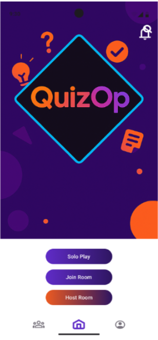
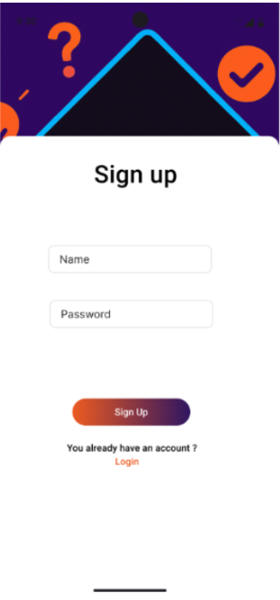
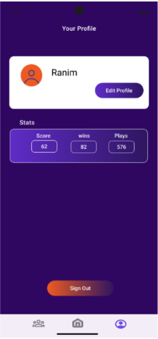
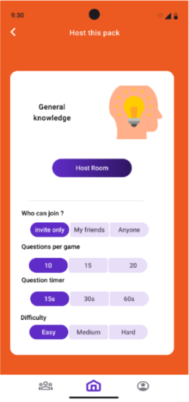
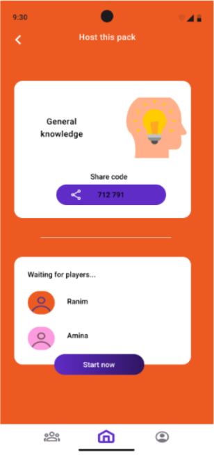
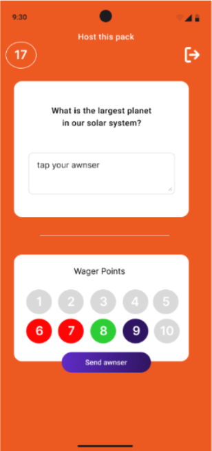
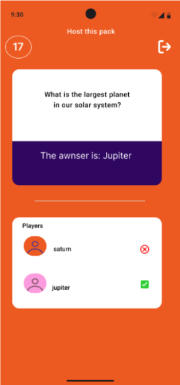
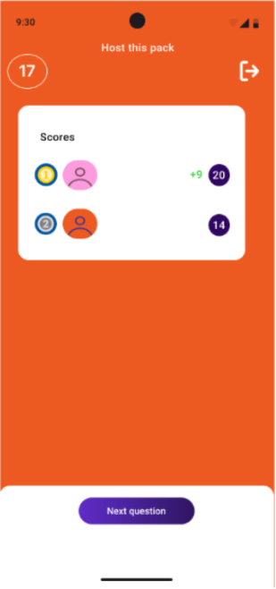
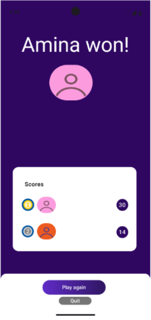

# QuizGame — Android Quiz Application

An Android quiz application developed using Java, Firebase, and the Open Trivia Database API.

## Features

- User registration and login with Firebase Authentication
- User profiles and profile editing
- Quiz gameplay with questions from Open Trivia Database
- Score tracking and winner screen
- Friends feature

## Technologies

- Java
- Android Studio
- Firebase Authentication
- Cloud Firestore
- Volley
- Open Trivia Database API
@'
# QuizGame — Android Quiz Application

QuizGame is an Android application developed in Java. It allows users to play trivia quizzes, challenge friends, host rooms, and track scores.

## Features

- User registration and login
- User profiles and profile editing
- Trivia questions from the Open Trivia Database API
- Multiple quiz categories and difficulty levels
- Solo quiz gameplay
- Host and join quiz rooms using room codes
- Friends feature
- Scores and leaderboard

## Technologies

- Java
- Android Studio
- Firebase Authentication
- Cloud Firestore
- Volley
- Open Trivia Database API

## Screenshots

### Application and User Profile

### Quiz Setup and Gameplay

### Scores and Results

'@ | Set-Content README.md
